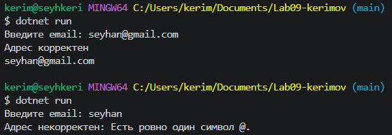
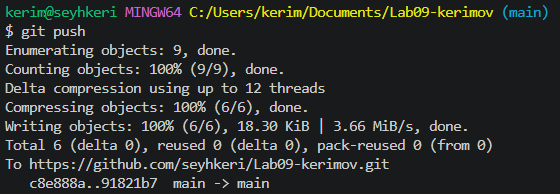

# Практическая работа №9

**ФИО:** Керимов Сейхан Заурбекович
**Группа:** ИСП-243
**Дата:** 24.10.2026

## Что изучено
Работа со строками как с неизменяемыми массивами символов: встроенные методы вроде .ToUpper() или .ToLower() всегда возвращают абсолютно новую строку, поэтому их результат обязательно нужно записывать в переменную или сразу выводить в консоль.
Поиск подстрок и анализ содержимого текста с помощью методов .Contains(), .StartsWith(), .EndsWith(), а также извлечение точных фрагментов с помощью .Substring()` по указанному индексу и длине.
Оптимизация сборки текста: при частой конкатенации строк (через +=) в циклах выделяется много лишней памяти, поэтому для эффективного динамического построения строк без создания промежуточных копий необходимо использовать класс StringBuilder.

## Скриншоты

